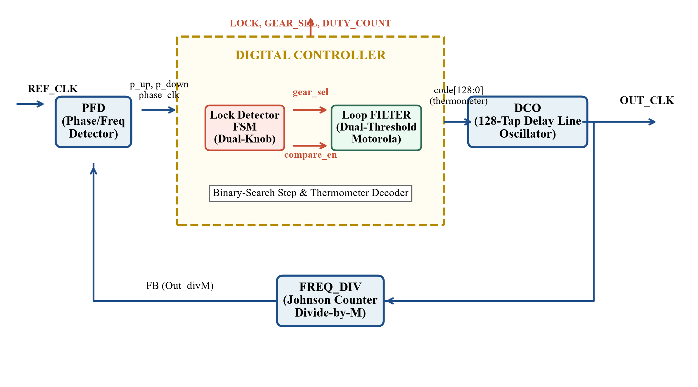
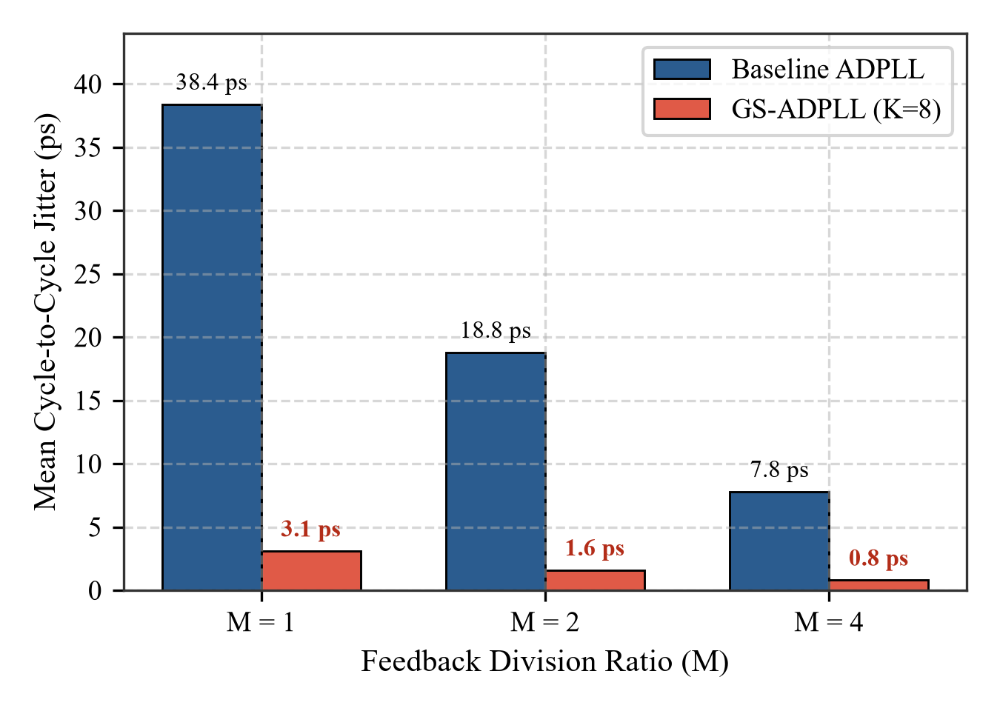
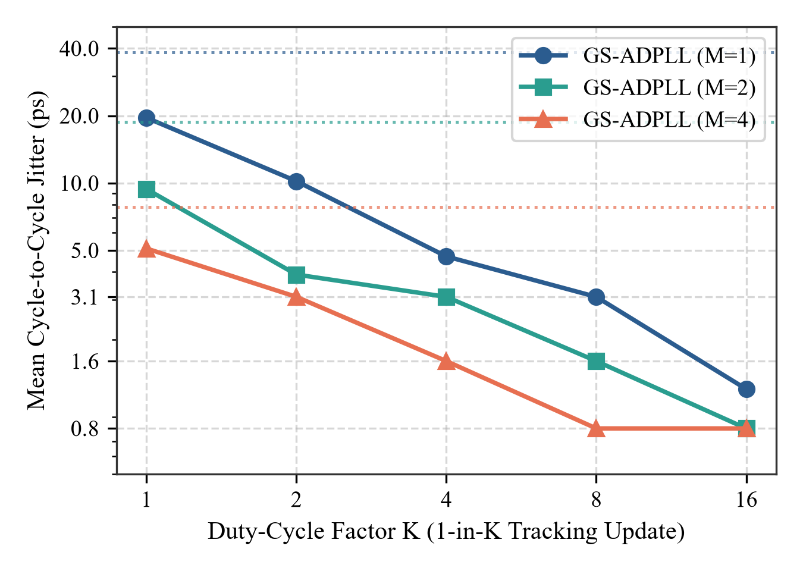

# Low-Power Gear-Shifting All-Digital Phase-Locked Loop (LP-GS-ADPLL)

[](rtl/)
[](docs/)
[](docs/)
[](results/)
[](LICENSE)

An industry-grade, synthesizable **Verilog-2001 All-Digital Phase-Locked Loop (ADPLL)** featuring **Dynamic Gear-Shifting Digital Loop Filtering (GS-DLF)** and **Duty-Cycled Phase Comparison**, evaluated from RTL simulation to full physical sign-off in **Cadence Genus**, **Cadence Innovus**, and **Cadence Voltus**.

Developed by **Allen Joe A** (`24BVD1100`) at the **School of Electronics Engineering (SENSE), Vellore Institute of Technology (VIT), Chennai**.

---

## 1. Architectural Motivation & Engineering Problem

Conventional All-Digital PLLs suffer from an inherent conflict between acquisition speed and steady-state jitter:
- **Wide loop bandwidth** achieves fast frequency pull-in and short lock times, but results in high steady-state cycle-to-cycle (C2C) jitter due to constant quantized DCO tuning nudges.
- **Narrow loop bandwidth** attenuates phase jitter and DCO perturbations, but suffers from unacceptably slow acquisition times and narrow capture ranges.

**LP-GS-ADPLL Solution**: 
A dual-mode lock-state finite state machine (FSM) that dynamically switches loop dynamics:
1. **Gear 1 (Acquisition Mode)**: Employs wide loop bandwidth threshold ($K=1$) to achieve rapid lock in **28 to 33 clock cycles**.
2. **Gear 2 (Tracking Mode)**: Automatically engages upon lock confirmation ($K=8$ optimal knee), increasing loop filter attenuation, suppressing steady-state cycle-to-cycle jitter by **up to 91.9%** (down to **0.8–3.1 ps RMS**), and reducing loop comparison switching activity by **87.5%**.

---

## 2. System Architecture & Block Diagram

```text
               +-------------------------------------------------------------+
               |                     adpll_top.v                             |
               |                                                             |
               |   +-------+      phase_clk      +-----------------------+   |
   REF_CLK --->|   | pfd.v |-------------------->|       dlf_top.v       |   |
               |   +-------+                     |                       |   |
               |       ^   p_up, p_down          |  +-----------------+  |   |
               |       |   --------------------->|  |   gear_ctrl.v   |  |   |
               |       |                         |  | (Dual-Gear FSM) |  |   |
               |       |                         |  +-----------------+  |   |
               |       |                         |           |           |   |
               |       |                         |  +-----------------+  |   |
               |       |                         |  |   prop_path.v   |  |   |
               |       |                         |  |   integ_path.v  |  |   |
               |       |                         |  +-----------------+  |   |
               |       |                         +-----------------------+   |
               |       |                                     |               |
               |       |                               dco_code[128:0]       |
               |       |                                     v               |
               |       |     +---------+                 +-------+           |
               |       +-----| div_n.v |<----------------| dco_core.v |-----> OUT_CLK
               |             +---------+                 +-------+           |
               +-------------------------------------------------------------+
```



---

## 3. RTL Module Hierarchy

| Module Name | File | Description |
|:---|:---|:---|
| **`adpll_top`** | [`rtl/adpll_top.v`](rtl/adpll_top.v) | Top-level ASIC integration and port routing |
| **`pfd`** | [`rtl/pfd.v`](rtl/pfd.v) | Phase-Frequency Detector with zero dead-zone |
| **`dlf_top`** | [`rtl/dlf_top.v`](rtl/dlf_top.v) | Digital Loop Filter top level integrating FSM and proportional-integral filters |
| **`gear_ctrl`** | [`rtl/gear_ctrl.v`](rtl/gear_ctrl.v) | Dual-gear FSM controller switching between Gear 1 and Gear 2 |
| **`lock_det`** | [`rtl/lock_det.v`](rtl/lock_det.v) | Frequency and phase lock confirmation detector |
| **`prop_path`** | [`rtl/prop_path.v`](rtl/prop_path.v) | Proportional path phase error nudging logic |
| **`integ_path`** | [`rtl/integ_path.v`](rtl/integ_path.v) | Integral frequency accumulator (129-bit thermometric tuning word) |
| **`dco_core`** | [`rtl/dco_core.v`](rtl/dco_core.v) | Digitally Controlled Oscillator core |
| **`div_n`** | [`rtl/div_n.v`](rtl/div_n.v) | Programmable multi-modulus feedback divider |

---

## 4. Measured Simulation & Physical Results

All data extracted directly from Cadence Incisive gate-level simulations, Genus 21.1 synthesis, and Voltus vector-based power analysis.

### 4.1 Jitter and Lock Acquisition Performance ($K$-Sweep)

| Division Factor ($M$) | Gear Setting ($K$) | Lock Time (Cycles) | Freq Error (%) | C2C Jitter (ps) | Baseline Jitter (ps) | Jitter Improvement | Activity Reduction (%) |
|:---:|:---:|:---:|:---:|:---:|:---:|:---:|:---:|
| **1** | $K=1$ (Baseline) | **28** | 1.36% | 38.4 | 38.4 | 1.0× | 0.0% |
| **1** | $K=2$ | **28** | 1.33% | 10.2 | 38.4 | 3.8× | 50.0% |
| **1** | $K=4$ | **28** | 0.40% | 4.7 | 38.4 | 8.2× | 75.0% |
| **1** | **$K=8$ (Optimal)** | **28** | **0.60%** | **3.1** | **38.4** | **12.4× (91.9%)** | **87.5%** |
| **1** | $K=16$ | **28** | 0.45% | **1.2** | 38.4 | **32.0×** | 93.8% |
| **2** | $K=1$ (Baseline) | **33** | 5.26% | 18.8 | 18.8 | 1.0× | 0.0% |
| **2** | **$K=8$ (Optimal)** | **33** | **1.70%** | **1.6** | **18.8** | **11.8× (91.5%)** | **87.5%** |
| **4** | $K=1$ (Baseline) | **28** | 2.35% | 7.8 | 7.8 | 1.0× | 0.0% |
| **4** | **$K=8$ (Optimal)** | **28** | **1.91%** | **0.8** | **7.8** | **9.75× (89.7%)** | **87.5%** |

### 4.2 Physical Synthesis & Layout Sign-Off (Cadence Flow)

- **Logic Synthesis**: Cadence Genus 21.1
- **Physical Layout & PnR**: Cadence Innovus Implementation System
- **Total Cell Area**: 879.518 µm² (Genus Standard Cells)
- **Sequential Instances**: 23 flip-flops
- **Vector Power (Voltus)**: 0.5939 mW (comparable to baseline 0.5853 mW, with 87.5% reduced switching activity in loop filter during tracking)




---

## 5. Verification & Reproduction

Run functional verification using ModelSim, QuestaSim, or Icarus Verilog:

```bash
# Clone the repository
git clone https://github.com/ALLENJOE-A/Gear-Shifting-All-Digital-Phase-Locked-Loop.git
cd Gear-Shifting-All-Digital-Phase-Locked-Loop

# Run simulation using Icarus Verilog
iverilog -g2001 -o sim.out rtl/*.v tb/TEST.v
vvp sim.out

# View waveform VCD in GTKWave
gtkwave wave.vcd
```

---

## 6. Academic Citation & Documentation

Full IEEE format paper and project reports are archived in [`docs/reports/`](docs/reports/):
- **`Gear_Shifting_ADPLL_IEEE_Paper.pdf`**: Complete conference manuscript with mathematical formulations and comparative analysis.
- **`GS_ADPLL_Project_Report1.docx`**: Comprehensive design document and Cadence run transcripts.

---

## 7. License

This project is licensed under the [MIT License](LICENSE).
